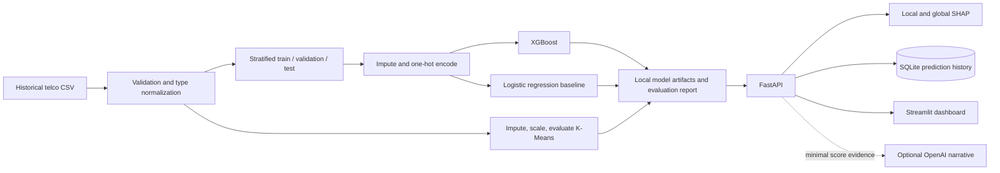

# Architecture

Training writes local, git-ignored artifacts. FastAPI loads those artifacts and the source snapshot for lookup and scoring. The dashboard consumes API summaries and individual results. SQLite stores prediction history locally. Optional OpenAI receives only risk band, estimated probability, and segment; API failure returns local fallback text.
